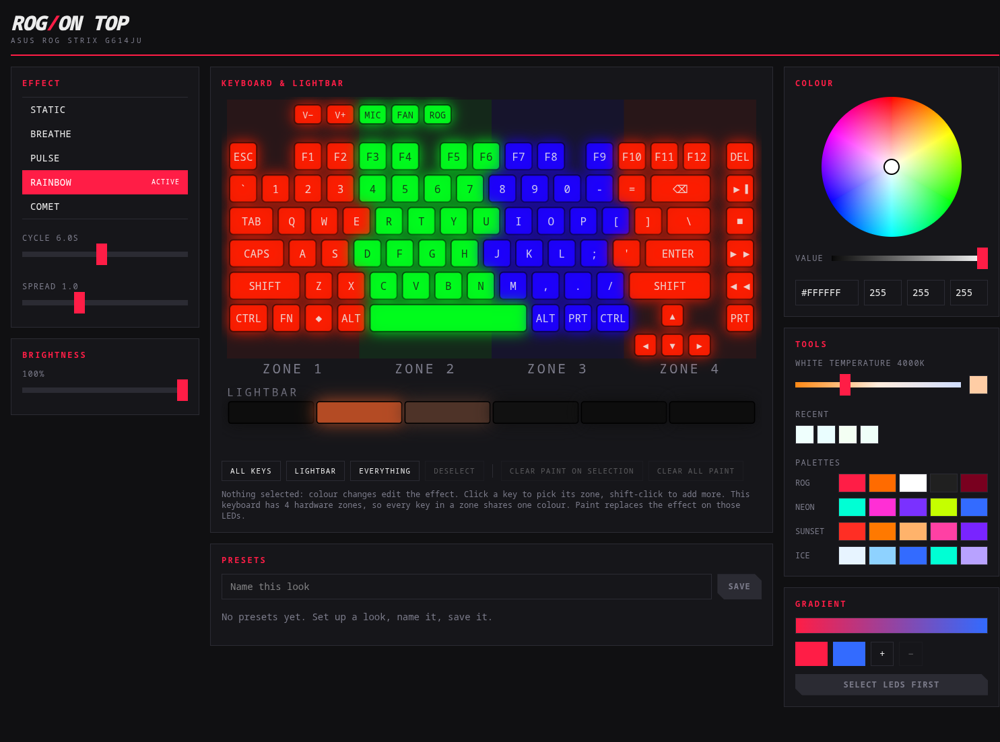

<div align="center">

# ROG / ON TOP

**Your ROG laptop's lights, under your control. No Armoury Crate. No Windows. No nonsense.**

[](LICENSE)




</div>

---

## What is this?

A tiny Rust daemon (`rogd`) that talks straight to your laptop's Aura controller, a CLI (`rogctl`) for scripting it, and a slick web UI at `http://127.0.0.1:7777` that draws your actual keyboard and lets you paint it.

It started as a lightbar that glows while [Claude Code](https://claude.com/claude-code) works, then got ambitious.

## Features

| | |
|---|---|
| **Real keyboard layout** | The full G16 US layout, drawn live. Click a zone, see the colour change on screen and on your keys. |
| **Colour, properly** | HSV wheel, hex/RGB inputs, warm-to-cool white slider, recents, palettes, and a 2 to 4 stop gradient builder. |
| **Presets** | Save any look, star your favourites, pick one to load at boot. Your last look survives restarts. |
| **Effects** | Static, breathe, pulse, rainbow, comet, with cycle speed and hue spread. |
| **Per-zone paint** | Paint individual zones and lightbar LEDs on top of any effect. |
| **Claude Code overlay** | Open Claude sessions take over the lightbar: orange comet while working, red pulse when it needs you, green when done. Your keyboard keeps its look. |
| **One writer** | A single daemon owns the device, so nothing fights over the LEDs. |
| **Locked down** | Binds to `127.0.0.1` only and rejects foreign `Origin`/`Host` headers, so a random website can't drive your LEDs. |

## Install

You need Rust, Node 20+, and a ROG laptop.

```sh
git clone https://github.com/lebiraja/rog-on-top && cd rog-on-top

(cd web && npm ci && npm run build)      # the UI gets embedded into the binary
cargo build --release

install -Dm755 target/release/rogd target/release/rogctl -t ~/.local/bin
install -Dm644 packaging/rogd.service ~/.config/systemd/user/rogd.service
sudo install -Dm644 packaging/99-rog-on-top.rules /etc/udev/rules.d/
sudo udevadm control --reload && sudo udevadm trigger

systemctl --user enable --now rogd
```

Then open <http://127.0.0.1:7777>.

> **Heads up:** `asusd` also drives the Aura device. Stop its aura control or the two will fight and your LEDs will flicker.

## Use it

```sh
rogctl effect rainbow --period-ms 4000
rogctl effect static ffffff
rogctl effect comet ff1744
rogctl brightness 40
rogctl state
```

### Claude Code lightbar

Point your Claude Code hooks at `rogctl hook <event>`, with events `start`, `working`, `ask`, `done` and `end`:

```json
{ "hooks": { "UserPromptSubmit": [{ "hooks": [{ "type": "command", "command": "rogctl hook working" }] }] } }
```

Hooks never fail loudly: if `rogd` is down they quietly do nothing, so they can't block Claude.

## How it works

```text
 browser UI ──┐
 rogctl ──────┼──► rogd ──► layers: effect → paint → Claude overlay
 Claude hooks ┘      │
                     └──► 20 fps frames ──► /dev/hidraw ──► keyboard + lightbar
```

Read more: [architecture](docs/architecture.md) · [HTTP and socket API](docs/API.md) · [protocol notes](docs/protocol-g614ju.md) · [plan](docs/plans/rog-on-top.md)

## Hardware support

Honesty section. This is verified on exactly **one** machine:

| Model | Status |
|---|---|
| ROG Strix G614JU (`0b05:19b6`) | Verified. 4-zone keyboard, 6-LED lightbar. |
| Other ROG laptops | Untested. Profiles exist for 140 models as data only. |

Fun fact we learned the hard way: asusd's database lists the G614JU as per-key RGB, but on real hardware it is **4-zone**. The UI draws every key anyway and tells you each zone shares one colour.

Got a different ROG? A probe tool is on the roadmap and your results would help a lot. Open an issue with your model and `lsusb` output.

## Roadmap

- [x] Daemon, CLI, web UI, presets, persistence, Claude overlay
- [ ] More effects: rain, ripple, starry night, fire, directional wave
- [ ] Music reactive (system audio to lights)
- [ ] Automation: AC vs battery, time of day, sleep and wake
- [ ] `rog-probe` for onboarding new models
- [ ] Per-key editing for laptops that really have per-key RGB

## Contributing

Issues and PRs welcome, especially hardware reports. Run `cargo test` and `(cd web && npm test)` before sending anything.

## License and credits

Apache-2.0, see [LICENSE](LICENSE) and [NOTICE](NOTICE). Built on the shoulders of [asusctl](https://gitlab.com/asus-linux/asusctl), whose reverse-engineering of the Aura protocol and keyboard layouts made this possible (those data files stay MPL-2.0).

Not affiliated with or endorsed by ASUS. ROG and Armoury Crate are trademarks of ASUSTeK Computer Inc.
